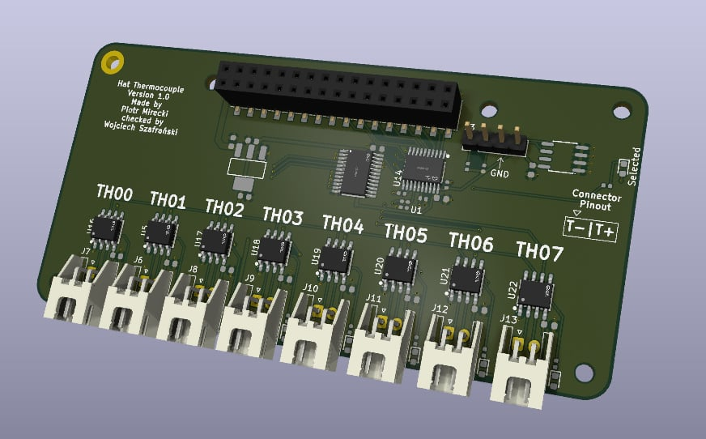

Dokumentacja Hat'a: Moduł wejść termopar

## Sekcja 1: Dokumentacja Hat'a

### Krótki opis projektu
Hat thermoucople umożliwia wykonywanie pomiarów temperatury przy użyciu termopar. 
Płytka jest wyposażona w 8 wejść oraz przetwornik analogowy cyfrowy, dedykowany do obsługi termopar typu K ze zintegrowaną kompensacją zimnego końca

### Zgodność ze standardem ChainBus

* ✅  Używa złącza ChainBus, nie zmienia jego miejsca ani pinoutu.
* ✅  Używa wyłącznie interfejsów I2C, SPI lub UART i nie inicjuje samodzielnie nowych transmisji (Nie jest master'em I2C albo SPI).
* ✅  Spełnia wymagania mechaniczne standardu (wymiary PCB, rozstaw otworów).
* ✅  Pobiera maksymalny prąd zgodny z ilością na jednego hat'a
* ✅  Obsługuje napięcie wejściowe BRD_VIN do wartości 48V.

### Komunikacja i adresowanie
Układ komunikuje się za pomocą jednokierunkowego interfejsu SPI w trybie tylko do odczytu. 
To które wyjście jest aktualnie odczytywane zależy od stanu pinu CS układu scalonego MAX31855KASA+T, do ustalaniu stanu tych pinów zastosowany został I2C multipexer

| Układ (IC)                | Funkcja         |  Address   |
| :------------             | :-------------- | :--------: |
| **TCA9535PWR_C130204**    | I2C multiplexer | `0000000b` |

#### Magistrala SPI
Urządzenia SPI podłączone są bezpośrednio do magistrali systemowej bez użycia dodatkowych multiplekserów.

| Układ (IC)         | Funkcja                     | chainbus/multiplexer |
| :----------        | :-------------------------- | :------------------: |
| **MAX31855KASA+T** | Sterownik silnika krokowego |      `chainbus`      |

### Pinout złączy

| Jn       | Co              | Jaki pin co robi                                                       |
| :-----   | :---------------| :----------------------------------------------------------------------|
| **TH00** | Termopara 1     | Pin 1 Ujemne wejście Termopary  Pin 2 Dodatnie wejście Termopary |
| **TH01** | Termopara 2     | Pin 1 Ujemne wejście Termopary  Pin 2 Dodatnie wejście Termopary |
| **TH02** | Termopara 3     | Pin 1 Ujemne wejście Termopary  Pin 2 Dodatnie wejście Termopary |
| **TH03** | Termopara 4     | Pin 1 Ujemne wejście Termopary  Pin 2 Dodatnie wejście Termopary |
| **TH04** | Termopara 5     | Pin 1 Ujemne wejście Termopary  Pin 2 Dodatnie wejście Termopary |
| **TH05** | Termopara 6     | Pin 1 Ujemne wejście Termopary  Pin 2 Dodatnie wejście Termopary |
| **TH06** | Termopara 7     | Pin 1 Ujemne wejście Termopary  Pin 2 Dodatnie wejście Termopary |
| **TH07** | Termopara 8     | Pin 1 Ujemne wejście Termopary  Pin 2 Dodatnie wejście Termopary |

### Typ możliwych termopar 
Termopary typu K, J, N, T, S, R lub E. Przetwornik umożliwia rozdzielczość temperatury do 0,25°C, pozwala na odczyty do +1800°C i tak niskie jak -270°C, a dokładność termopary wynosi ±2°C dla temperatur od -200°C do +700°C w przypadku termopar typu K.
